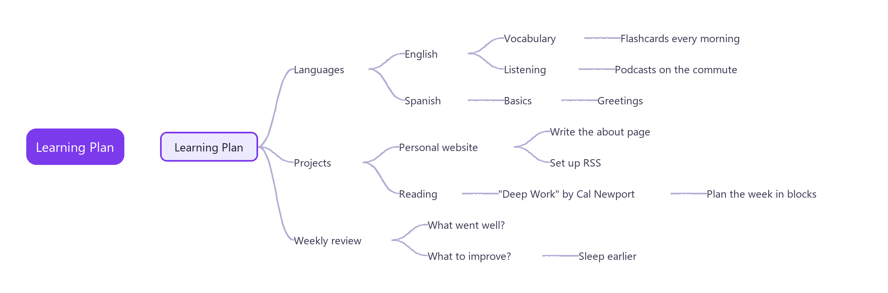

# MindTree

Turn Markdown outlines into an XMind-style mind map in Obsidian. Headings and list items are the nodes, and every change is written straight back to the Markdown file. The note stays the single source of truth — no sidecar files, no private format.

[中文说明](README.zh-CN.md)

> Works on desktop and mobile. The interface follows Obsidian's language (Chinese or English).

## Features

### Map from plain Markdown

Open any `.md` file as a mind map. Headings (`#` to `######`) and nested lists become a left-to-right tree, and the body text under a node becomes its note. There is no import or export step — the note *is* the map, and every edit is saved straight back to the Markdown file.

### Folding

Keep large notes readable:

- **Fold or unfold** a node with Space, or by clicking the toggle next to it. A folded node shows how many descendants it hides.
- **Show a set number of levels** with `1`–`9`; everything deeper is folded.
- Fold state is **saved per note**, so a note reopens exactly as you left it.

### Editing

- **Keyboard-first.** Add, rename, delete, reorder and re-parent nodes. Undo and redo cover every change. While typing a new node, Enter saves it and starts the next sibling, and Tab starts a child.
- **Drag and drop** to move a node or a whole branch, with a drop indicator for child, before and after. When a spot is not allowed, the dragged label says why. A heading dropped into a list becomes a list item, with its sub-headings nested under it.
- **Multi-select** with Shift+click or by Shift+dragging a box on empty space, then delete, copy or drag the selected nodes together. On touch screens, the multi-select button in the toolbar lets taps add or remove nodes and a drag on empty space draw the box. A setting swaps the mouse gestures, so a plain drag draws the box and Shift+drag or the middle button pans.
- **Copy, cut and paste** whole branches. The clipboard holds plain Markdown, so you can paste into any note.
- **Numbered lists** count up again after you add, delete, move or reorder their items.
- **Task checkboxes** (`- [ ]`) can be ticked directly on the map. Cmd/Ctrl+click opens a link inside a node.
- If the note changes somewhere else while you edit, the edit is not saved, a notice says so, and the map reloads the latest text.

### Notes panel

Select a node to read its note rendered as Markdown — code blocks included — and edit it in place.

### Table of contents

A sidebar built from headings, with:

- **Fold** each heading branch, plus **expand all / collapse all**.
- **Search** to filter headings, showing each match together with its ancestors.
- **Two-way sync**: click a heading to centre the map, or click a node to reveal and highlight its heading in the sidebar.

### Search

Search across node text and notes, and jump between matches.

### Themes

Five built-in themes: Default, Soft, Business, Bold and Mono.

### Export

Export the map as **PNG**, **SVG**, or **OPML** (for interchange with other outline and mind-map tools).

### Settings

A settings tab to choose the default theme, the default visibility of the table of contents and notes panels, and whether a plain drag on empty space selects or pans.

## Keyboard shortcuts

| Key | Action |
| --- | --- |
| Arrow keys | Move the selection |
| Tab / Enter | Add a child / a sibling (while typing a new node: save it and add the next one) |
| F2 or double-click | Edit the node text |
| Delete | Remove the node and its branch (all selected nodes when several are selected) |
| Shift+click, Shift+drag | Add nodes to the selection; Esc clears it |
| Alt+Up / Alt+Down | Reorder among siblings |
| Space | Fold or unfold |
| 1 to 9 | Show that many levels |
| Cmd/Ctrl+C, X, V | Copy, cut, paste a branch |
| Cmd/Ctrl+Z, Shift+Z | Undo, redo |
| Cmd/Ctrl+F | Search |

## Install

Search for **MindTree** in Settings → Community plugins.

## Data

Notes are never modified except by your own edits. Map and table-of-contents fold state, theme and panel visibility are kept in the plugin's `data.json`, keyed by file path.

## License

MIT
