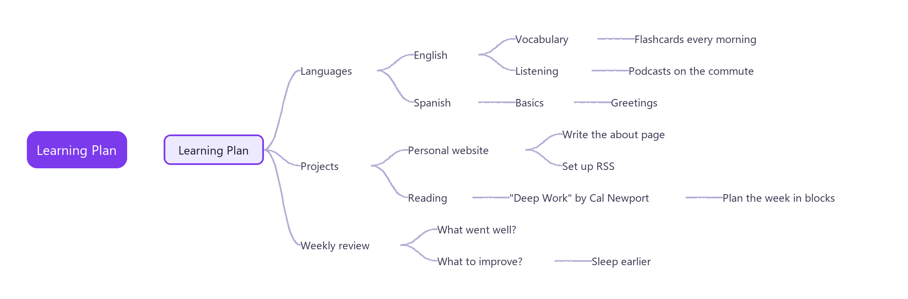
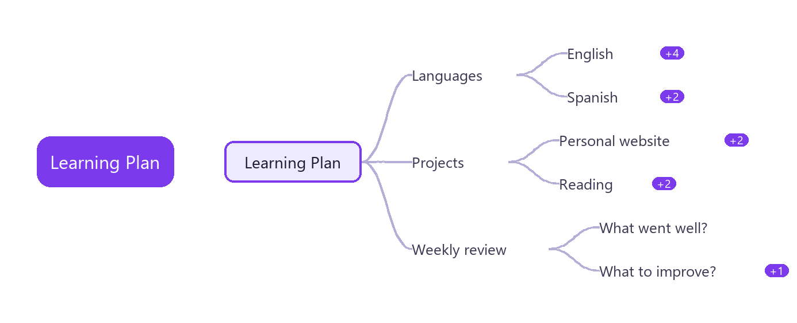

# MindTree

在 Obsidian 里把 Markdown 大纲变成 XMind 风格的思维导图。标题和列表项就是节点，每次修改都直接写回 Markdown 文件——笔记始终是唯一的数据源，没有附属文件，也没有私有格式。

[English](README.md)

> 支持桌面端和移动端，界面语言跟随 Obsidian（中文或英文）。



## 功能

### 由 Markdown 生成导图

任意 `.md` 文件都能直接当导图打开。标题（`#` 到 `######`）和嵌套列表自动变成从左到右的树，节点下方的正文就是它的备注。无需导入导出——笔记本身就是导图，每次编辑都直接写回 Markdown 文件。

### 折叠

让大笔记保持清爽：

- **折叠 / 展开**节点：按空格，或点击节点旁的圆形开关。折叠后的节点会显示它收起了多少个子节点。
- **按层数展开**：数字键 `1`–`9` 显示对应层数，更深层自动折叠。
- 折叠状态**按笔记分别保存**，下次打开还是你上次的样子。

### 编辑

- **键盘优先**：新增、改名、删除、调整顺序、改变层级，撤销和重做覆盖每一步修改。输入新节点时按 Enter 保存并接着新建下一个同级节点，按 Tab 则新建子节点。
- **拖拽**移动节点或整条分支，放置时有「作为子节点 / 前面 / 后面」三种提示。不能放的位置，拖动中的标签会说明原因。标题拖进列表时会变成列表项，它的子标题也跟着变成下级列表项。
- **多选**：Shift+点击节点，或在空白处按住 Shift 拖出选框，选中的节点可以一起删除、复制或拖动。触屏上可以点工具栏的多选按钮，之后点按节点即可加入或移出选择，在空白处拖动就是框选。设置里可以对调鼠标手势，改成直接拖动框选，Shift+拖动或中键拖动平移。
- **复制、剪切、粘贴**整条分支，剪贴板里是普通 Markdown，可以直接贴进别的笔记。
- **有序列表**在新增、删除、移动或调整顺序后会自动重新编号。
- **任务复选框**（`- [ ]`）可以直接在导图上勾选；Cmd/Ctrl+点击打开节点里的链接。
- 编辑时如果笔记在别处被改动，这次编辑不会保存，会弹出提示，导图随即换成最新内容。

### 备注面板

选中节点即可查看按 Markdown 渲染的备注（代码块也支持），并就地编辑。

### 目录

从标题生成侧边目录，支持：

- **折叠**每个标题分支，以及**一键全部展开 / 全部折叠**。
- **搜索**过滤标题，命中项会连同其祖先一起显示。
- **双向定位**：点目录居中导图，点节点则在目录中展开并高亮对应标题。

### 背诵模式

把列表变成闪卡。收起每个一级列表项下面的答案，逐个展开核对——只改变显示，不改文件。

把问题写成一级列表项，答案放在它的正文或子节点里：

```markdown
## 科学
- 什么是光合作用？
  植物利用阳光把二氧化碳和水转化为葡萄糖和氧气。
  - 发生在叶绿体中
  - 需要叶绿素
- 物质有哪几种状态？
  - 固态
  - 液态
  - 气态
```

点工具栏的闭眼图标，或运行「开关背诵模式」。选中一个问题先自己想，再按空格查看答案。模式开启时不能编辑。



### 搜索

搜索节点文字和备注，并在匹配项之间跳转。

### 主题

五套内置主题：默认、柔和、商务、鲜明、单色。

### 导出

导出为 **PNG**、**SVG** 或 **OPML**（OPML 可和其它大纲、导图工具互通）。

### 设置

设置面板可配置默认主题、目录和备注面板的默认显示状态，以及在空白处直接拖动是框选还是平移。

## 快捷键

| 按键 | 作用 |
| --- | --- |
| 方向键 | 移动选择 |
| Tab / Enter | 添加子节点 / 同级节点（输入新节点时：保存并接着新建下一个） |
| F2 或双击 | 编辑节点文字 |
| Delete | 删除节点及其分支（多选时删除全部选中节点） |
| Shift+点击、Shift+拖动 | 把节点加入选择，Esc 取消多选 |
| Alt+上 / Alt+下 | 在同级之间调整顺序 |
| 空格 | 折叠或展开（背诵模式下为显示/隐藏答案） |
| 1 到 9 | 显示对应层数 |
| Cmd/Ctrl+C、X、V | 复制、剪切、粘贴分支 |
| Cmd/Ctrl+Z、Shift+Z | 撤销、重做 |
| Cmd/Ctrl+F | 搜索 |
| Esc | 退出背诵模式 |

## 安装

在「设置 → 第三方插件」里搜索 **MindTree** 即可。

## 数据存放

插件只在你亲自编辑时才会改动笔记。导图与目录的折叠状态、主题、面板开关都保存在插件的 `data.json` 里，按文件路径区分。

## 许可

MIT
